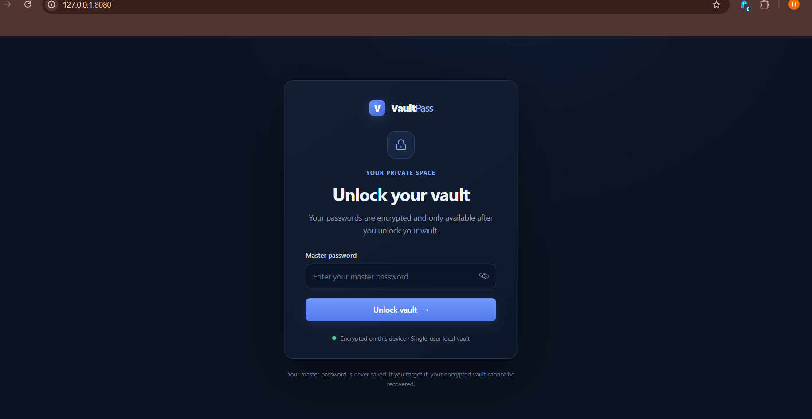

# 🔐 VaultPass — Local Password Manager

VaultPass is a local, single-user password manager built with **FastAPI, SQLite, Jinja2, and vanilla JavaScript**.

It provides a modern dashboard for managing website credentials, generating strong passwords, and protecting saved records using browser-based encryption.

> **Project status:** Local-development and learning project. It has not undergone an independent security audit and should not be considered production-ready.

## ✨ Features

- 🔐 **Encrypted credential storage** using AES-256-GCM.
- 🌐 **Browser-side encryption and decryption** using the Web Crypto API.
- 🔑 **Master-password authentication** with a password-based key derivation process.
- 🗄️ **Local SQLite database** for storing encrypted credential records.
- 🛡️ **Challenge-response unlock flow** for authentication.
- ⏱️ **Automatic session expiration** after 30 minutes.
- 🔒 **Vault locking** that discards the browser's in-memory encryption key.
- 🎲 **Cryptographically secure password generator**.
- 🔎 **Credential search and management** through a web dashboard.
- 🛡️ **CSRF protection** for state-changing requests.
- 🖥️ **Local-first architecture** without a requirement for a hosted backend.

## 🛠️ Technology Stack

| Technology | Purpose |
|---|---|
| Python | Backend application logic |
| FastAPI | API endpoints and web application |
| Uvicorn | ASGI development server |
| Jinja2 | HTML templating |
| SQLite | Local database |
| HTML5 | Page structure |
| CSS3 | Styling and responsive layout |
| JavaScript | Frontend interactions |
| Web Crypto API | Browser-side cryptographic operations |
| AES-256-GCM | Authenticated encryption |
| PBKDF2-HMAC-SHA-256 | Master-password-based key derivation |
| HKDF | Cryptographic key separation |
| Windows DPAPI | Protection of the authentication verifier on Windows |

## 📸 Application Preview

<!-- Add your dashboard screenshot to screenshots/vaultpass-dashboard.png -->


*Add the screenshot file at the path shown above for the image to appear.*

## 📂 Project Structure

```text
VaultPass/
├── app.py
├── requirements.txt
├── README.md
├── .gitignore
├── static/
│   ├── css/
│   │   └── style.css
│   └── js/
│       └── app.js
└── templates/
    └── index.html
```

The local SQLite database is created as `vaultpass.sqlite3` by default, unless `VAULTPASS_DB_PATH` specifies another location.

## ⚙️ Installation and Setup

### Prerequisites

- Windows 10 or Windows 11
- Python installed and available in your PATH
- Git
- A modern browser that supports the Web Crypto API

### 1. Clone the repository

```powershell
git clone https://github.com/harishjambagi13-creator/VaultPass.git
```

### 2. Enter the project directory

```powershell
cd VaultPass
```

### 3. Create a virtual environment

```powershell
python -m venv venv
```

### 4. Activate the virtual environment

```powershell
Set-ExecutionPolicy -Scope Process -ExecutionPolicy Bypass
.\venv\Scripts\Activate.ps1
```

### 5. Install dependencies

```powershell
python -m pip install -r requirements.txt
```

### 6. Start the application

```powershell
python -m uvicorn app:app --reload --host 127.0.0.1 --port 8000
```

If port `8000` is unavailable on your computer, use port `8080` instead:

```powershell
python -m uvicorn app:app --reload --host 127.0.0.1 --port 8080
```

### 7. Open VaultPass

For port 8000:

- **Application:** http://127.0.0.1:8000/
- **API documentation:** http://127.0.0.1:8000/docs
- **Health check:** http://127.0.0.1:8000/health

If you used port 8080, replace `8000` with `8080` in the URLs.

On first use, the application asks you to create a master password of at least 12 characters. Keep it safe: the application cannot recover a forgotten master password.

Press `Ctrl + C` in the terminal to stop the development server.

## 🔐 Security Architecture

VaultPass is designed to keep credential encryption and decryption in the browser.

### Encryption and key derivation

- Credential records are stored as AES-GCM authenticated ciphertext.
- Each record uses a random nonce and an authenticated record identifier.
- The browser uses PBKDF2-HMAC-SHA-256 with 600,000 iterations to derive key material from the master password.
- HKDF separates the derived material into keys for different cryptographic purposes.
- The master password is not sent to the server or stored as plaintext.
- The server stores a random per-vault salt and an authentication verifier.
- On Windows, DPAPI protects the authentication verifier for the current Windows user.

### Authentication and sessions

- Vault unlock uses a short-lived, single-use challenge-response proof.
- The protected verifier is not sent to the browser during login.
- Sessions are held in server memory and expire after 30 minutes.
- A random, HttpOnly, SameSite=Strict cookie identifies the session.
- State-changing requests require a CSRF token.
- The browser's derived encryption key remains in memory and is discarded when the vault is locked or the page is reloaded.

### Important limitations

VaultPass is a local-development project, not a production-ready hosted password manager.

- It supports a single user.
- There is no master-password recovery.
- There is no encrypted backup or export feature.
- Sessions are not persisted across server restarts.
- There has been no independent security audit.
- Anyone who compromises the computer, browser, or an unlocked session may be able to access vault data.
- Database recovery under a different Windows user account is not supported by the DPAPI-based verifier protection.
- Local development uses HTTP, so it should not be exposed to untrusted networks.
- The server cannot inspect credential fields because it intentionally receives encrypted records.

**A working authentication flow does not guarantee that the complete system is secure. Review and test the cryptographic implementation before storing real credentials.**

## 🚧 Future Improvements

- Automated unit and integration tests
- Independent security review
- Encrypted backup and recovery design
- Improved accessibility and responsive behavior
- Password-strength analysis
- Password reuse warnings
- More comprehensive security documentation

## 👨‍💻 Author

**Harish Jambagi**

GitHub: [@harishjambagi13-creator](https://github.com/harishjambagi13-creator)

Project repository: [VaultPass](https://github.com/harishjambagi13-creator/VaultPass)

## 📄 License

No license has been specified yet. If you want others to reuse, modify, and distribute your project, consider adding an appropriate open-source license.
